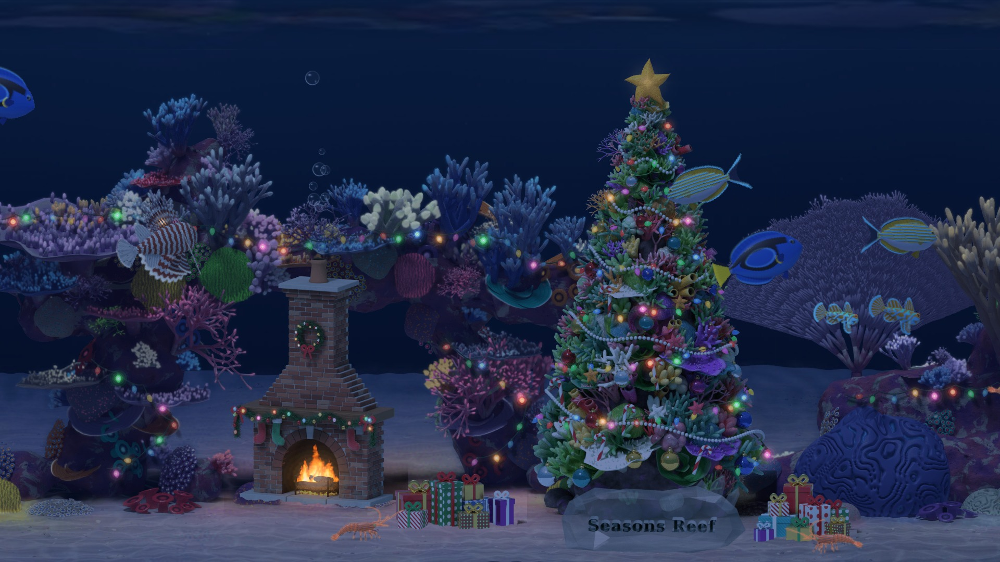

# Reefer

Reefer is a project for building native aquarium screensavers for Roku. We use BrightScript to animate fish, water, and reef life from artwork packaged with each screensaver. Once installed, the reef runs entirely on the Roku, without streaming video, an internet connection, or a computer running in the background.



## The screensavers

| Screensaver | What we’re building |
| --- | --- |
| **Rellie Reef** | Our sideloaded development tank, based on Reef Glass. It has animated reflections, a swaying anemone, peppermint shrimp, and an optional Christmas scene. |
| **Seasons Reef tank** | The edition we’re preparing for the Roku Streaming Store. It has its own Blender-rendered reef, six fish species, and a build that checks the ZIP size. See the [Seasons Reef tank guide](market/README.md). |

Both use Roku’s normal idle activation and offer lighting and seasonal settings. The renderer draws a layered 2D scene with pre-rendered sprites and updates fish movement independently of the camera. We target 1080p and 30 FPS and test on Roku Ultra and Roku Smart Soundbar hardware.

## Preview on a computer

From the repository root, install Python 3 and Node.js if needed, then run:

```sh
python3 -m pip install Pillow imagequant zopfli
npm ci --prefix preview --ignore-scripts
python3 preview/run.py
```

Use a Python virtual environment if your system manages Python packages. Pillow is enough for Rellie Reef. The Seasons Reef preview and build also need imagequant and zopfli.

- [Rellie Reef](http://127.0.0.1:8765/)
- [Seasons Reef tank](http://127.0.0.1:8765/?market=1)
- [Rellie Reef at 720p](http://127.0.0.1:8765/?resolution=720)

## Build and install on Roku

The repo includes the runtime artwork. The build uses the checked-in renders, so Blender is only needed when editing or regenerating artwork.

```sh
mkdir -p build
python3 preview/run.py --device-zip build/rellie-reef-current.zip
python3 tools/check_scene.py build/rellie-reef-current.zip

python3 market/build.py
python3 tools/check_scene.py build/seasons-reef-tank.zip
```

1. Enable developer mode on the Roku and note the installer address shown on the TV.
2. From a computer on the same network, open that address and sign in as `rokudev` with the device’s developer password. Upload and install the ZIP for the edition you want to test. Each Roku has one sideload slot, so the upload replaces the previous sideloaded app. [Roku developer setup](https://developer.roku.com/dev/docs/developer-setup)
3. On the TV, open **Settings → Theme → Screensavers**, choose the installed edition, and preview or set it as active. [Roku screensaver guide](https://developer.roku.com/dev/docs/screensavers)

### Reef Loader for local devices

Reef Loader packages **Rellie Reef** and **Seasons Reef tank** in one developer ZIP. It uses the Rellie Reef name on Roku. Install it once, then open **Settings → Theme → Screensavers → Rellie Reef → Change screensaver settings → Tank**. Choose a tank with **OK**, press **Back**, and open **Preview** to see the new selection. The choice persists on the device, and Lighting and Season apply to either tank.

```sh
mkdir -p build
python3 preview/run.py --reef-loader --device-zip build/reef-loader.zip
python3 tools/check_scene.py build/reef-loader.zip
```

This build uses Pillow, imagequant, and zopfli. It includes both tanks on disk and loads the selected tank’s textures at runtime. Use the standalone Seasons build for Roku Store packaging. With the local preview server running, try [Rellie in Reef Loader](http://127.0.0.1:8765/?loader=1&tank=tank) and [Seasons in Reef Loader](http://127.0.0.1:8765/?loader=1&tank=seasons).

## Work on the reef

- [`app/`](app/) contains Rellie Reef’s manifest, BrightScript, SceneGraph settings, and base scene.
- [`authoring/`](authoring/) holds Rellie Reef’s Blender sources, render scripts, exported sprites, and placement data.
- [`market/`](market/) contains the Seasons Reef app, its art pipeline, and its packaging tools.
- [`preview/`](preview/) serves both editions in a local browser simulator.

See the [local preview and Blender guide](docs/local-preview.md) for asset edits and the [Phase 1 evaluation and device runbook](docs/phase-1.md) for the original upstream comparison and hardware test procedure.

## Credits and licensing

The renderer builds on Reef Glass v1.1.3. The inherited code is Apache-2.0 and the inherited artwork is CC0 1.0. See the [Rellie Reef notices](app/NOTICE.md), [artwork credits](app/CREDITS.md), and [Seasons Reef notices](market/app/NOTICE.md) for attribution and the licensing status of project additions.
